# Reimagining Project map

Design proposal, 2026-10-10. Extends the exploration in [RFC 0049](../rfcs/0049-repository-docs-and-project-maps.md); it does not change shipped behaviour or accept that RFC's open decisions. The interactive concept in the accompanying conversation uses Acme's existing demo documents and Compose declarations.

Implementation task: [Reimagine Project map as a spatial project atlas — #68](https://github.com/m9sh/galley/issues/68). The maintainer agreed with this design direction on 2026-10-10; formal ADR review and validation remain part of delivery.

**The job:** while reading a project or reviewing a change, I want to see where this fits, follow its connections, and open the source that explains them.

## What feels wrong today

The current Documents view is a selected document between two lists. Architecture and Infrastructure use the same arrangement for entities. The screenshots produced by `e2e/repo.mjs` show that most of the visual emphasis falls on classification and editing, rather than orientation.

- **There is no larger place to recognise.** Selecting another item replaces the centre; the reader cannot retain a picture of the surrounding project.
- **Four lenses ask for a choice before explaining the benefit.** Documents, Architecture, Infrastructure and Decisions look similar but contain different kinds of evidence.
- **Editing arrives before understanding.** Type, folder-wide classification and Connect forms occupy the selected item's most prominent space. On a phone, those controls precede the connections.
- **Evidence overwhelms the overview.** Repeated origin labels, paths, quotations and line numbers make a careful audit possible, but make the structure difficult to scan.
- **A relationship has no readable geometry.** “depends on (from)” needs interpretation; line stubs do not establish direction or distinguish containment, references and proposals.

These are design observations, not findings from reader sessions. The evidence model is a useful foundation and should survive the redesign.

## Recommended direction: a project atlas

Keep the user-facing name **Project map**. Its first sentence is **See where this fits. Follow the sources.** A useful map answers three questions in order: Where am I? What connects here? Where can I go?

The main surface is a spatial map with stable landmarks, labelled regions and one selection panel. It should feel considered and navigable at first glance: ample space, readable labels, restrained connections, the existing Sage/palette tokens, serif place names and quiet sans-serif controls. Motion explains a move between levels; nothing floats or continually rearranges.

### Places, connections and levels

| Part | Meaning | Behaviour |
| --- | --- | --- |
| Region | A source folder, a configuration file or an explicitly declared boundary | Its label names that origin. Folder grouping never means a service boundary or dependency. |
| Landmark | A document, declared entity or explicit reader proposal | Select to inspect; **Read document** or **Open source** opens the evidence. Selection does not immediately leave the map. |
| Connection | One explicit source relationship | Direction and verb are visible when focused. Selecting it names both endpoints and opens its source evidence. |
| You are here | The document/entity associated with the current reading position | Remains distinct from the item being inspected. **Back to my place** restores it. |
| Your chapter | An optional sequence the reader explicitly assembled | A separately labelled route overlay. It does not become a documented relationship or imply completion. |

Three levels keep it useful as projects grow:

1. **Overview:** regions and a small number of document landmarks, with counts of what is inside each region. Entry documents are selected by explicit README/index identity and link counts, with those reasons available. This is a navigation choice, never a claim about importance or meaning.
2. **Neighbourhood:** one selected place and its direct connections. Secondary links recede. Expanding a connection reveals its neighbourhood without rebuilding the whole map.
3. **Source:** a selected relationship's evidence, or the actual article in Galley's reader. Returning restores the same map selection, level and camera position.

At overview scale, aggregate counts label references between regions. They are not system dependencies. At neighbourhood scale, reveal the actual document names and directional links. Never shrink labels into unreadable text to fit more nodes.

### One workspace, a clear distinction between sources

Replace the four equal lens tabs with two source choices inside the map:

- **Documents:** documents and their explicit Markdown links; decision records keep their statuses and supersession relationships. Type filters and decision history are available within this view.
- **Declared systems:** entities and relationships the selected configuration files declare. Use Architecture/Infrastructure as filters where useful, with **Read configuration** before loading more. “Declared” stays in the label; this is never an observation of live infrastructure.

Keep the same selection, source preview, search, navigation and list patterns in both. Do not draw document references and configuration dependencies as indistinguishable lines in one graph. Cross-source context can appear in the selection panel with its precise origin; a name match remains an **Unverified suggestion**.

**Documents** is the initial view for the first implementation. It already has data without requiring a new configuration read. A future choice of initial view based on repository evidence is a research question, not an automatic “architecture” guess.

### Detail follows selection

The selection panel contains, in order:

1. Name, kind, path and origin; current or conflicting status when present.
2. **Read document** / **Open source**, and **Show connections**.
3. A short list of relevant incoming/outgoing connections with source verbs.
4. **Evidence** disclosure with exact file, section, line and commit. Selecting an edge opens this evidence directly.
5. **Add to chapter**, **Add a note**, and an **Edit classification…** disclosure. Proposal and connection forms live here rather than occupying the initial map.

No generated summary is required. A real source excerpt can describe a place, labelled as an excerpt rather than Galley's explanation. Quotations must retain their source and pass through the existing safe rendering boundary.

### Smart behaviour that is explainable

- **Useful starting position:** opening Map from an article selects that document; opening from a review retains the originating chapter and chosen base/head commit. An unrelated document is not substituted silently.
- **Stable placement:** identifiers, folder/configuration containment and deterministic ordering place nodes. Existing nodes stay put as indexing adds more; explicit refresh may change the snapshot and explains changes.
- **Density management:** begin with the selected item and a bounded neighbourhood. Aggregate high-degree connections with counts; expand deliberately. No whole-repository force simulation.
- **Find a place:** search indexed names and paths, disclose how much has been indexed, and move the camera to the chosen result. Search results remain available as a normal list.
- **Reading routes:** reuse existing chapter choices. Numbered stops are **Added by you**, with Previous/Next. A route can connect unlinked documents because its line represents reading order, not a source relationship.
- **Review context:** **Changed in this review** marks changed documents and **Worth checking** identifies existing source evidence. Do not propagate a speculative blast radius through the graph.
- **Honest incompleteness:** **36 of 120 documents indexed** remains visible. Loading, omitted files, broken links, absent anchors and contradictory sources have inspectable states, not empty-map treatment.

All of this runs locally on the existing commit-pinned index. “Smart” is a better presentation of verifiable context, not a dependency on a remote model.

## Interaction and small screens

On desktop, the map fills the workspace; a compact selection panel occupies one side. Search and view choices sit above it; **Fit map**, **Back to my place** and zoom controls stay local to the map. A minimap is deferred until large-repository sessions show that it helps.

On phones, show a legible focused neighbourhood with the selected place and a few labelled neighbours. **More connections** exposes the remainder with a count. Selecting a place opens the familiar bottom-sheet detail pattern; closing it returns focus to that place. Do not scale down the desktop canvas or force people to pan through tiny labels.

**Map / List** are two presentations of the same filtered model and selection. The list remains first-class for precise scanning, keyboard use and screen readers. It carries all evidence and actions, not a reduced fallback.

Keyboard: Tab reaches landmarks and labelled controls; Enter selects; a labelled **Read document** action opens the article. Offer camera keys only when the canvas itself has focus, without stealing text-field keys or the reader's existing shortcuts. Escape closes the innermost detail, then returns to the prior level, then uses the existing library return contract. Pointer drag and pinch are conveniences; buttons and list navigation can accomplish every task.

Selection and relationship origin must have words and shape/style cues as well as colour. Honour reduced motion, 44px touch targets, visible focus, the existing type-size settings and all palette contrast floors. In production, use Galley's existing tokens and stacking levels.

## Decision required before implementation

[ADR 0026](../adr/0026-an-evidence-only-project-map.md) explicitly requires a map made of lists. This proposal contradicts that presentation rule. Production changes should begin only after the maintainer reviews a new **Proposed** ADR, with a title such as **A spatial project map and an equivalent list share one evidence model**.

The replacement should preserve ADR 0026's constraints on explicit links, provenance, classifications, conflicts and suggestions, and replace only its presentation choice:

> Project map offers a bounded spatial presentation and an equivalent navigable list over the same evidence model. Every visible relationship retains its origin and source. Stable placement, aggregation and explicit expansion keep the map legible. The list exposes the same items, relationships, evidence and actions at every screen size.

The old decision remains Accepted while this is a proposal. On acceptance, follow the [decision-record process](../adr/README.md): reciprocal supersession links, RFC references, indexes and enforcement. Do not edit the accepted decision to pretend it already permits this design.

This plan also proposes answers to RFC 0049's open design questions about initial neighbourhood and outline versus mindmap. They remain proposals until reviewed; the diagram-extraction spike stays separate.

## Deliver in useful stages

| Stage | Concrete deliverable | Exit gate |
| --- | --- | --- |
| Validate the direction | Interactive concept; sessions on locating a document, tracing a decision and returning to reading; proposed superseding ADR | Readers can explain what places and lines mean without a tour. Resolve source choices and phone interaction before implementation. |
| Ship the document map | Stable spatial neighbourhood, selection panel, source evidence, search, Map/List, partial-index states and mobile flow | All current document-map capabilities remain reachable; no false source relationships; Back restores the paragraph and map state. |
| Add declared systems | Adapt existing `LensModel` entities/relations to the same map and panel; source-labelled Architecture/Infrastructure filters | Configuration declarations are legible and distinguishable from live systems and document mentions. No new parser is required. |
| Join reading and review context | Existing chapter route overlay, you-are-here marker and explicit change/context badges | Route lines cannot be confused with documented edges; return keeps review drafts, Viewed state and base/head identity. |
| Scale and refine | Region overview, count aggregation and incremental placement for large repositories | Dense, disconnected and partly indexed fixtures stay legible and responsive; readers can recover their place after expanding and collapsing. |

Stages are separate reviewable changes. Estimates follow a layout/performance spike and the first reader sessions; there is no delivery-date claim yet. The first shipped slice should already look and behave like a map, rather than releasing its editing forms first.

## Engineering starting points

Reuse `ProjectIndex` and explicit `Edge` evidence in [docindex.ts](../../src/core/docindex.ts), `LensModel` / `Entity` / `Relation` in [architecture.ts](../../src/core/architecture.ts), the library's existing commit identity, and the session [reading sequence](../../src/ui/library/reading-sequence.ts). No new source-of-truth graph or duplicated indexing pass.

Introduce a pure, bounded map view model for visible nodes, grouped counts, selected relationships and provenance. Keep deterministic placement separately testable from rendering. Prototype a plain DOM node layer and SVG edge layer: native controls for nodes/actions, labelled edges and one shared selection controller. Evaluate an additional layout dependency only if the spike demonstrates a concrete need, with the normal licence/ADR checks.

Extract map orchestration from [RepoReader](../../src/ui/library/repo-reader.ts) into a focused library component rather than adding another large stateful branch. [repo-views.ts](../../src/ui/library/repo-views.ts) and [repo.css](../../src/ui/library/repo.css) provide existing origin chips, controls and palette integration. Add a separate map-state bookmark for selection, filters, level and camera; keep the article's paragraph history intact. Camera state and map selection are session-only in the first release.

Static configuration inspection, sandbox boundaries, token handling, source budgets and private-note persistence remain governed by their existing decisions. Persistent camera layouts, new map exports or new stored content would need a separate privacy/storage decision; they are not needed here.

## Check the proposal with readers

Use 5–8 voluntary readers: newcomers and maintainers, with a small linked project, a monorepo, sparse docs and contradictory sources. Compare the current map with the proposed flow using matched tasks and alternate the order.

Ask each reader to:

1. Explain what the map shows after ten seconds, without an introduction.
2. Find the architecture overview and a decision it links to.
3. Select a connection, explain its direction and prove it from the source.
4. Explain the difference between a document link, a declared dependency and their own reading route.
5. Open a source paragraph, return, and identify their previous place.
6. Find a declared component's configuration on a phone; repeat the evidence task with the list and keyboard.
7. Describe what is unknown when only part of the repository has been indexed.

Record correct interpretations, mistaken relationships, navigation loss, steps/backtracking, evidence found and the reader's own description of effort. Proposed advancement target: all participants can inspect source evidence and recover their place; at least 80% explain the map's purpose and relationship meaning unaided. Any belief that declarations show live infrastructure or that a reading route is a source dependency blocks release until corrected and retested. These are proposed gates, not measured results.

Automated acceptance covers model bounds and determinism, cycles, high-degree nodes, isolated documents, duplicate names, missing links/anchors, contradictory statuses, indexing failures/cancellation and commit refresh. Browser checks cover native focus/return, touch, list parity, no label overlap, long titles/paths and no page overflow at 1,440 / 1,280 / 1,100 / 390 / 320px, light/dark, both densities and 17/24px text. Retain 100% source-file coverage and the full pre-push gate. Update Guide, COPY, UI map, architecture and rendered/store captures with implementation.

## Deliberately later

Diagram-to-entity extraction, semantic relationships inferred from prose, saved custom coordinates, automatic architecture summaries and live infrastructure integration each need separate evidence and data decisions. They are not prerequisites for a useful, spatial Project map.

Open decisions before building: whether Documents/Declared systems names are understood, whether mobile detail should initially occupy a sheet or an inline area, and the bounded layout/aggregation rules for each graph size. The inline concept is an interaction sketch using existing demo data; it does not establish those answers or claim production completeness.

## Concept checks

The accompanying interactive concept was rendered in Chrome at 1,440 and 1,024px in light appearance, 390px in light, and 320px in dark. Checks exercised selection, relationship evidence, source preview and return, chapter additions, list presentation and search; node bounds did not overlap or overflow, and there were no page errors. Desktop and phone captures were inspected and region-label collisions corrected. Documentation links pass `npm run docs:check`.

These checks cover the concept, not a production map implementation. Large-repository placement, pan/zoom, the proposed bottom sheet, real indexing/error states, full palette/type-size coverage and reader research are still delivery gates.

## First implementation slice — 2026-10-11

[Proposed ADR 0030](../adr/0030-spatial-project-map-with-an-equivalent-list.md) now states the presentation replacement for review. ADR 0026 remains Accepted. The extension's Map is unchanged; the build rejects the proposal modules from shipped bundles.

Run `npm run demo` and open `http://localhost:4173/?atlas`. This working document prototype uses `ProjectIndex`, the safe article renderer, real bundled handbook documents and Galley's fonts/tokens. It exercises inspection separate from focus, explicit **Show its connections**, **You are here**, **Back to my place**, source paragraph/return, Map/List, folder-grouped browsing, search, keyboard/pointer camera controls, the details sheet beside the map and the phone detail sheet. The shared **Reading settings** sheet follows the saved palette, appearance (including System), named typeface, text size, density and top glow. Reading uses Galley's actual palette carousel and type preview; Layout offers Density, and Keys describes implemented controls. Changes stay in this prototype session; no new provider, dependency or persistence is introduced.

The prototype is a spike, not a replacement for all current Map capabilities. It has no declared-system adapter, classification editor, notes, chapter/review overlays, refresh workflow or production article history integration. The UI now has only Map and List. List groups documents by their literal source folder; spatial overview connections/landmarks remain a future delivery slice. Evidence and unresolved-link previews are capped and disclose extra material. List pagination exposes all places within the model budget; full production action parity remains a delivery gate.

**Second pass, 2026-10-11.** The workspace is now one bar and the map:

- **One top bar.** It names the project and holds search, **Map**/**List**, **Details** and reading settings. The map runs edge to edge below it, with zoom, **Fit map** and **Back to my place** floating at its lower left and the indexing status at its lower right.
- **A neighbourhood that reads left to right.** **Linked from**, the focus, **Links to**: each lane is headed with its count, the focus sits centred among its neighbours, and **You are here** marks the reading place. Up to eight neighbours a side are shown (four on phones); the rest are one click away in List, filtered to that neighbourhood. Cards show a type icon and label, a two-line name and the folder.
- **Quiet lines.** Lines are neutral until a place is pointed at, tabbed to or selected; then its lines take the accent and the rest dim. Only then do links between two neighbours appear, dashed and routed around the focus. A line is selected by clicking it; there are no line labels, since the lanes already say which way links run.
- **A details sheet that makes room.** Selecting a place opens the sheet. On wider screens it is a full-height column beside the map that narrows the map instead of covering it, and is not modal; on phones it is the bottom sheet. It opens on **Preview**, the safe-rendered document without its repeated title. **Links** lists both directions and, for a neighbour, starts with the sentence that put it on the map. **Read**, **Show its connections** and **Close** sit together at the top; there is no footer. When the sheet leaves the map less than 720px, the lanes stack.
- **Search in a popup.** With the field empty it suggests recent documents and the places on this map. Typing ranks matches by title words, then paths, marks the matched words and says which matches are already on the map. Arrow keys, Enter and the pointer choose; Escape closes the popup, then clears the field. Choosing selects a document where it is, or makes it the new centre. More than eight matches offer **See all in List**; search never replaces the map.
- **Reading in the address.** Reading a document replaces the map with the article and puts **Back to map**, with the document's name, in the top bar. The demo writes the document into its own address (`?atlas&doc=…`): the browser's Back and Forward move between documents and the map, and a link opens a document directly. **Back to map** retraces those entries and restores the view, camera, scroll, sheet and preview position.

Cards keep explicit ADR/RFC prefixes as their label and the descriptive name below; original titles stay searchable and accessible. Distinct outline icons distinguish types without colour. List groups documents by literal source folder, with full paths and how many documents link to and from each.

### Layout and aggregation findings

- Native DOM places plus an SVG connection layer are sufficient for the bounded document view; no layout dependency is justified by this spike.
- The pure adapter keeps exact evidence, broken references, both conflicting statuses and original/corrected kinds. Presentation budgets are separate from source discovery: 2,000 places, 6,000 inspected connections, 12 evidence previews and 8 expanded neighbours per side. Counts disclose omitted material.
- A session placement cache allocates deterministic incoming/outgoing slots by path. Additional indexing does not move occupied slots, including a neighbour whose direction later changes. Clear the cache when the commit changes. Removed neighbours can leave gaps; compacting them needs a deliberate navigation/reset action.
- Small (9 documents), dense (309), sparse (39, including 30 isolated documents) and partial (32 of 39 indexed) demo fixtures exercise actual index adaptation. High-degree, reciprocal/cyclic, isolated, missing-anchor, conflicting-status and 2,000/6,000-budget cases are covered by the pure tests. Browser rendering stays at up to 17 places on desktop and 9 on phones, rather than shrinking a whole graph.
- Three lanes need no layout library. A line between neighbours on opposite sides bends around the focus and its lane heading; one between neighbours on the same side curves along the lane's outer edge. A two-way link is one line with an arrow at each end.
- Making room for the sheet is a grid column that grows in 0.24s (instantly under reduced motion). Lines are redrawn when the canvas resizes, without rebuilding the cards, so keyboard focus stays put.
- Folder grouping aggregates actual directional references, excluding links within a folder. The grouping does not infer system boundaries. Search can only use known titles/paths and explicitly names incomplete indexing.

Planning estimate after this spike: **4–6 focused implementation days** for production Documents (component extraction, article/refresh bookmarks, existing classification/note actions and Map/List parity); **2–3** for the existing declared-system adapter; **2–3** for chapter/review context; **2–4** for overview, scale and remaining polish. These are provisional engineering ranges, not dates or promises. They assume reuse of current parsers/providers and no new dependency; reader-session findings may change the design and estimates. Divide the document work into the controller/round-trip PR and the parity/refresh PR, each independently reviewable.

### Voluntary session protocol — ready, not yet run

**Participants: 0. Observations: none.** Recruit 5–8 willing readers spanning newcomers and maintainers; do not infer results from automated checks. Use bundled public fixtures, compare the existing `?repo=docs/architecture/overview.md` Map against `?atlas`, and alternate their order. Allow 20–30 minutes per session. Ask permission before recording; otherwise keep anonymous written observations. No product telemetry is added.

1. Show each view for ten seconds. Ask what the places and lines represent, and where the reader is now. Give no introductory tour.
2. Starting at Architecture overview, find ADR 0003. Inspect its connection, explain the direction and open the paragraph proving it. Observe whether selection and source navigation are confused.
3. Return to the map, inspect another place and recover the original reading place. Record navigation loss, backtracking and whether the camera/selection remain recognisable.
4. Repeat with List and keyboard, then phone details. Observe focus recovery and whether evidence can be located without geometry or gestures.
5. Use dense, sparse and partial fixtures. Ask what the map knows, what it has not read and why an isolated document has no connections. Show the RFC's broken anchor and ask what is missing.
6. Ask which source-choice name and detail treatment (beside the map, or over it on phones) they expect. Treat the answers as preferences, not proof that unbuilt declared-system or route behaviour works.

Open questions from the second pass, for review and these sessions:

- **Engineering and Product, blocking production:** in the extension the page belongs to GitHub or GitLab. Should reading a document from the map change that page's address, or stay in the reader's own Back history? The demo's `doc=` address is a prototype convenience, not a decision.
- **Design:** is a neighbour's preview, or the sentence connecting it to the focus, the better first view? The sheet opens on Preview, with the sentence at the top of Links.
- **Design:** does hiding links between neighbours until one is pointed at hide context readers need?
- **Design:** eight neighbours a side by default, instead of ADR 0030's earlier two. Does the fuller lane read as a map or as a list?

For each task, record the reader's explanation, correct/incorrect relationship interpretation, evidence found, return recovered, backtracking and their own description of effort. Leave participant rows empty until a session happens. Proposed gate: every participant can trace evidence and recover their place; at least 80% explain the purpose and document-line meaning unaided. Material false relationships require correction and retesting. Declared-system versus live-infrastructure and chapter-route distinctions require additional tasks once those slices exist, before their release.

Automation supports engineering confidence; it cannot fill these observation fields or accept ADR 0030. Human review and research remain outstanding.

### Matched comparison captures

The current extension Map and working prototype below use the same Architecture overview fixture, Sage/light, the Galley pairing, 20px text and Comfortable density. `e2e/project-map.mjs` regenerates them in `reports/e2e/` during `npm run test:e2e`; these reviewed copies are committed for the proposal. The prototype excludes known broken-anchor evidence from verified lines, so its incoming counts differ from the existing Map.

| Width | Current Map | Demo prototype |
| --- | --- | --- |
| 1,440px | 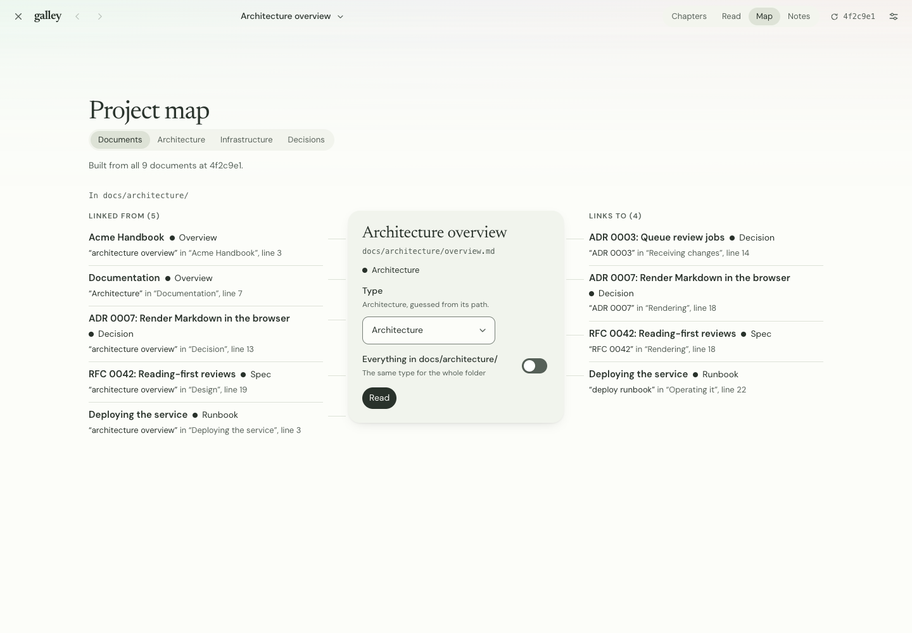 | 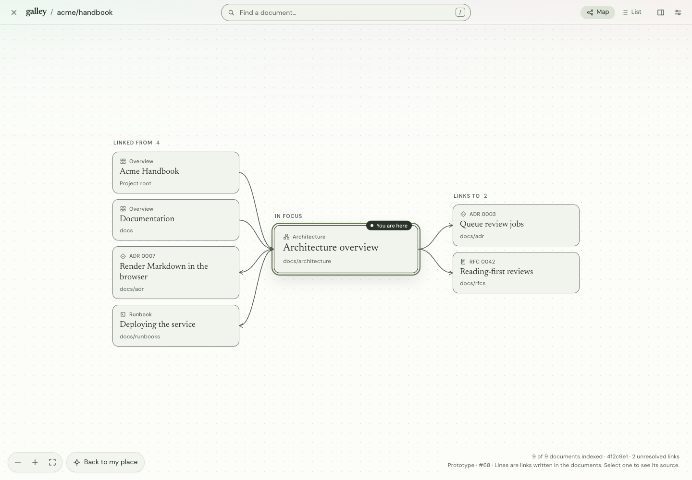 |
| 390px | 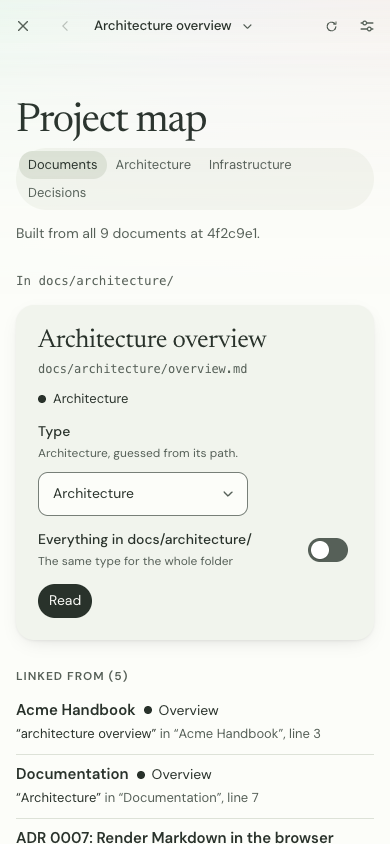 | 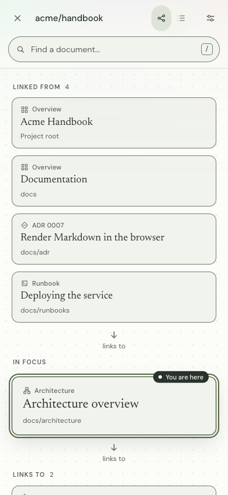 |

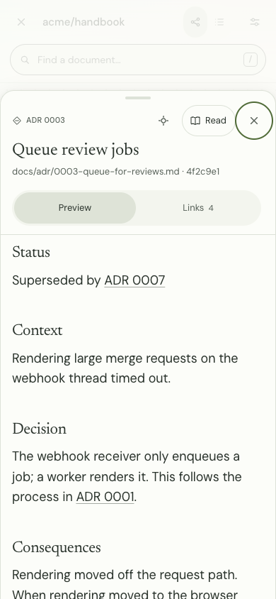

| Width | Folder-grouped List | Shared Reading settings |
| --- | --- | --- |
| 1,440px | 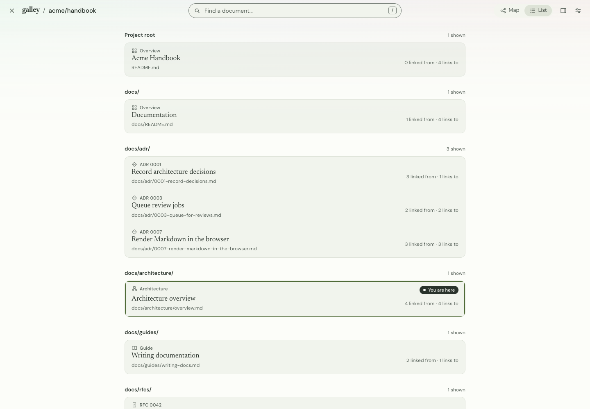 | 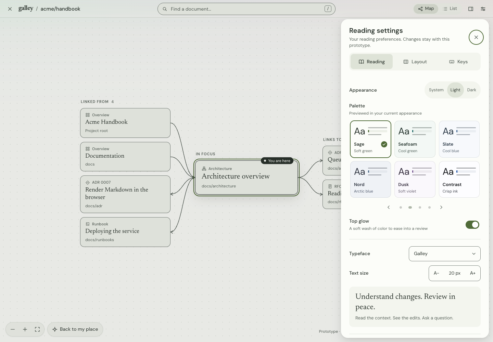 |
| 390px | 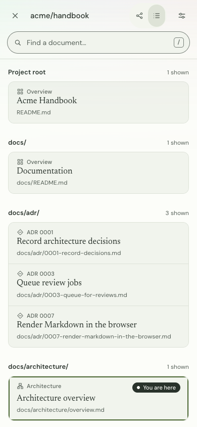 | 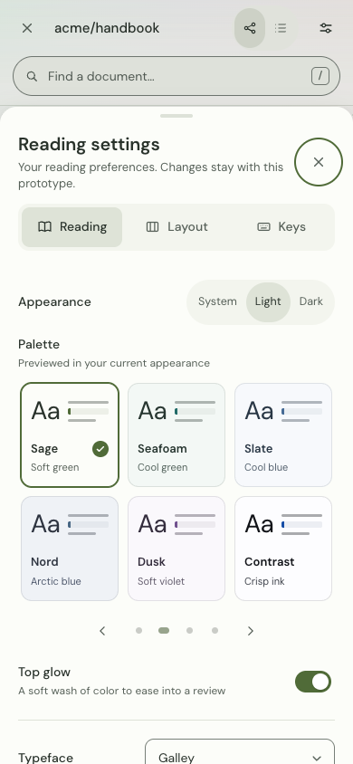 |

| Details sheet beside the map | Links, with the connecting sentence |
| --- | --- |
| 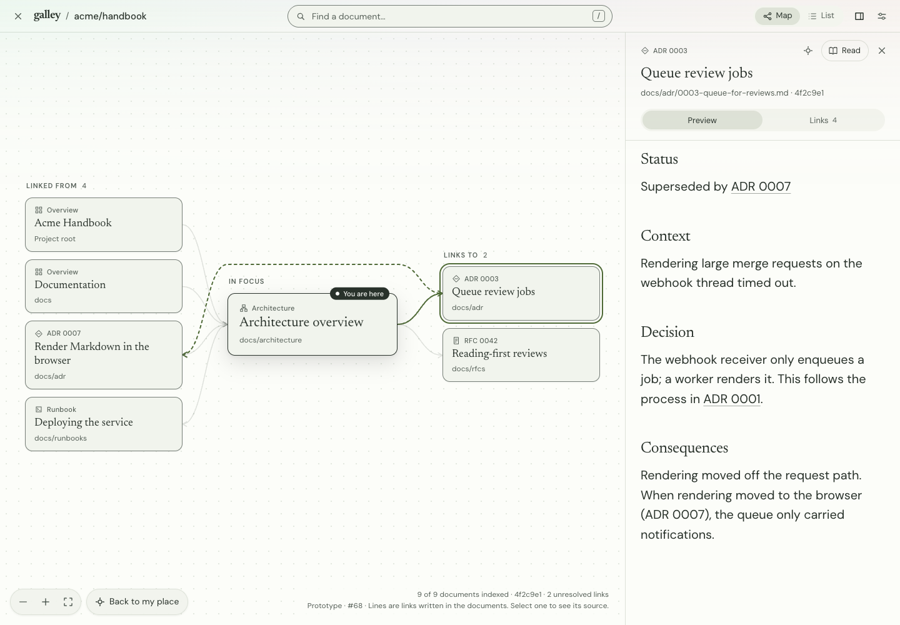 | 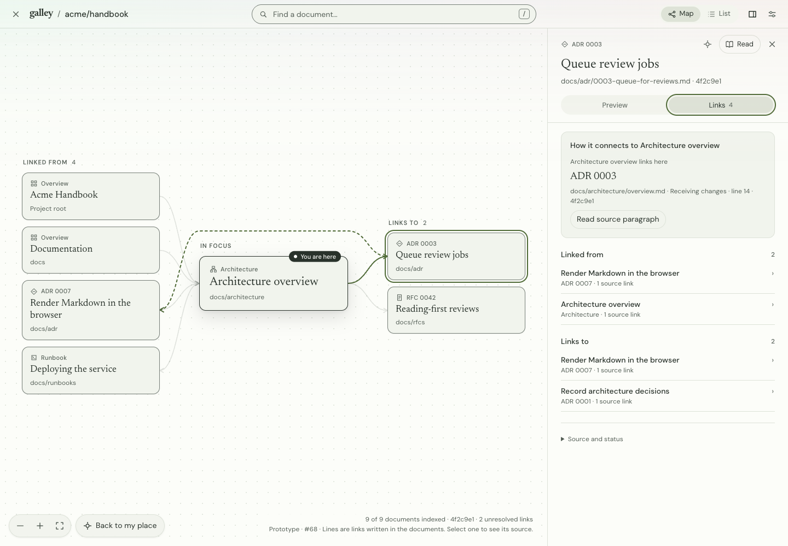 |

| Width | Search popup | Reading, with Back to map in the top bar |
| --- | --- | --- |
| 1,440px | 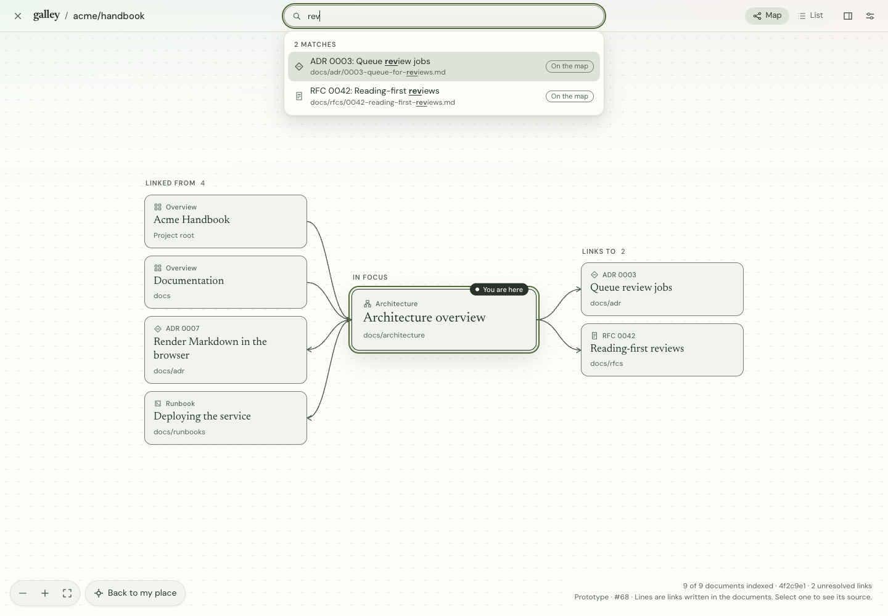 | 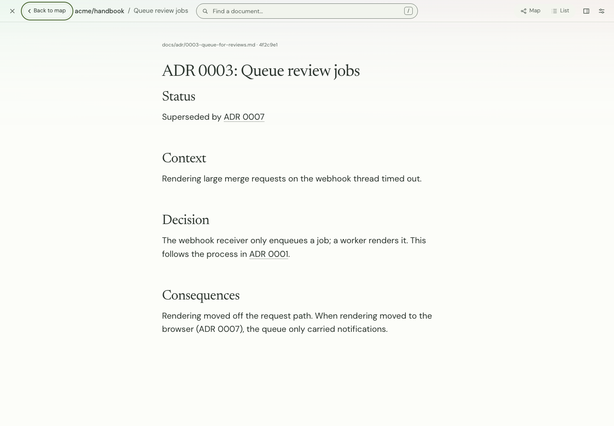 |
| 390px | 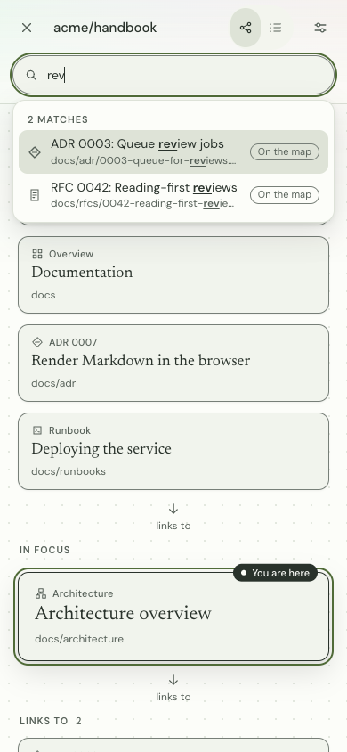 | 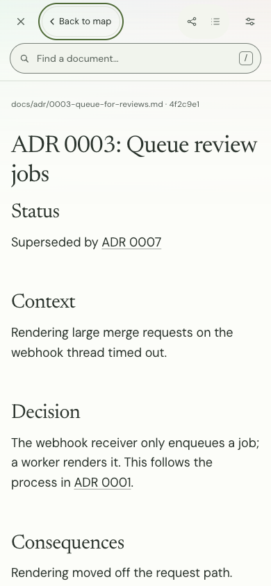 |

Engineering checks cover the one-bar layout, lane order and counts, lit and hidden lines, two-way arrows, the push sheet's geometry and the map it narrows, Preview first with header actions, stacking beside a narrowing sheet, the search popup (suggestions, ranking, marks, arrow keys, Enter, pointer, Escape, re-centring and **See all in List**), document links inside the preview, reading through the address with the browser's Back and Forward, opening a document from a link, evidence/article return with focus, stable selection, drag, wheel, pinch and keyboard camera controls, paginated folder-grouped List with link counts, hidden counts and the filtered List behind them, mobile sheet/focus return, partial/isolated/dense fixtures, closing during loading and read failure, independent sheet scrolling, shared settings focus/tab controls, all six named typefaces and live System appearance changes. Layout checks measure 80 combinations: Sage/Paper/Sepia/Contrast, light/dark, 1,440/1,280/1,100/390/320px, Comfortable 17px and Compact 24px. Place, metadata, border, line, lit line, You are here and chosen search result contrast are measured in all 19 light/dark palettes. Representative captures were visually inspected.

Local browser verification uses Chrome for Testing 139 for reader/demo checks and installed Chrome 155 for shipped-extension checks: the older build lacks the extension-loading protocol, while the installed browser disconnected during longer combined runs. No assertion or gate was weakened. CI verifies the full suite in its fresh browser environment.
